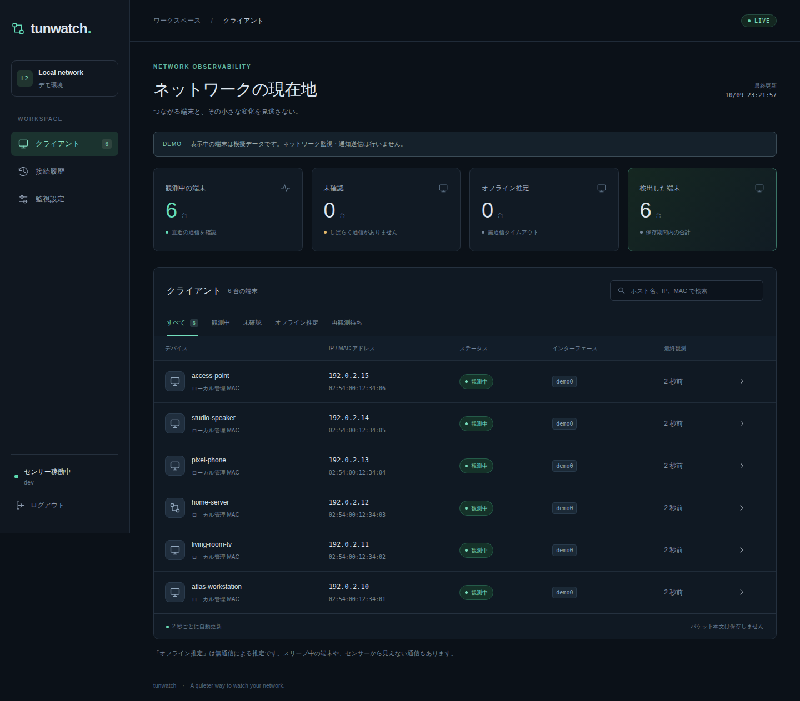

# tunwatch

**ネットワークの今を、ひと目で。** Linux の L2 インターフェースで端末の存在を観測し、接続状況・履歴・変化を可視化するネットワークモニターです。



Go の単一バイナリに React / Tailwind CSS の UI を同梱しています。フロントエンドのビルドには Bun を使用します。Linux amd64 / arm64 向けのコンテナは `ghcr.io/yude/tunwatch` に公開します。

## できること

- ARP、IPv4 / IPv6 の送信元、IPv6 Neighbor Discovery、DHCP、mDNS の受動観測
- 直結 IPv4 範囲に対する低頻度の ARP 探索（既定で有効、無効化可能）
- インターフェース・VLAN・MAC ごとの端末管理、IP、ホスト名、ベンダー、OS の推定根拠の表示
- SSE による 2 秒間隔の更新、検索、端末詳細、接続履歴、設定・センサー状態の確認
- 新規観測・再接続・オフライン推定の Discord Webhook 通知
- 状態変化を中心とした gzip 圧縮履歴、圧縮スナップショット、保存期間・容量制限
- Bearer token 認証付きの JSON API と、HttpOnly cookie を使う Web UI

**「通信がない」と「切断された」は同じではありません。** スイッチ配下のセンサーは他ポート間のユニキャストを通常受信できず、スリープ端末も応答しない場合があります。tunwatch はその制約を状態・通知・UI に明示します。全端末の検出保証、物理リンクの切断保証、機器認証の代替は提供しません。

## まずデモを試す

必要なもの: Linux、Go 1.26.8 以降、Bun 1.4.2。

```sh
git clone https://github.com/yude/tunwatch.git
cd tunwatch
export TUNWATCH_API_TOKEN="$(openssl rand -hex 32)"
make demo
```

`http://127.0.0.1:8080` を開き、環境変数のトークンでログインします。デモは架空の 6 台を表示し、1 台を周期的に無通信にします。**デモはパケットを受信せず、ARP・DNS・Webhook を送信しません。** データは `data-demo/` に保存します。

## Linux で監視する

```sh
make build
cp config.example.json config.json
# config.json の interfaces を ip -br link の実際の Ethernet 名へ変更
# 必要なら networks、タイムアウト、vendor_file も変更
sudo setcap cap_net_raw=ep ./bin/tunwatch
export TUNWATCH_API_TOKEN="$(openssl rand -hex 32)"
./bin/tunwatch -config config.json
```

ファイル capability を設定したバイナリは通常ユーザーで起動できます。再ビルド後は `setcap` を再実行してください。バイナリは `CGO_ENABLED=0` でビルドします。raw socket は起動時に開き、その後すべての OS スレッドで capability を破棄し、`no_new_privs` を設定してから HTTP を開始します。

トークンは 24 文字以上必須です。上記のようなランダムな値を使い、起動をまたいで同じ値を使う場合は Secret 管理機構などで安全に保管してください。設定ファイルには秘密情報を含めず、Git 管理できる構成にしています。

## Docker

```sh
docker pull ghcr.io/yude/tunwatch:latest
docker volume create tunwatch-data
# config.json: listen=127.0.0.1:8080、data_dir=/data、interfaces をホストの名前に変更
docker run --name tunwatch --detach \
  --network host \
  --cap-drop ALL --cap-add NET_RAW \
  --security-opt no-new-privileges --read-only \
  --env TUNWATCH_API_TOKEN \
  --mount type=bind,src="$PWD/config.json",dst=/etc/tunwatch/config.json,readonly \
  --mount type=volume,src=tunwatch-data,dst=/data \
  ghcr.io/yude/tunwatch:latest
```

Docker での capability 有効化の互換性を確保するため、コンテナは UID 0 / GID 65532 で起動します。必要な追加 capability は起動時の `NET_RAW` だけです。HTTP 稼働中の effective / permitted / inheritable capability はすべて空になります。UID は 0 のままなので、不要なホストディレクトリをマウントしないでください。`privileged`、`NET_ADMIN`、ホスト PID 名前空間、Docker socket は不要です。

ブリッジネットワークだけで起動すると見えるのはコンテナの L2 セグメントです。LAN を監視するには Linux ホスト上の `--network host`、または適切な macvlan などを使います。Docker Desktop の仮想マシン内から物理 LAN 全体が見えることは想定しません。

## Kubernetes / Kustomize

[`manifests/tunwatch`](manifests/tunwatch) は、`yudejp/k8s/manifests` のリソース分割、ConfigMap generator、Longhorn PVC、Recreate、プローブ、リソース制限の構成を参考にしています。

1. `config.json` の `node_profiles` に、配置候補の **実際の Node 名**と各ノードの VLAN インターフェース名を設定します。付属の `sensor-a` / `sensor-b` は置き換えが必要な例です。
2. 同じ監視対象 L2 セグメントへ接続された配置候補ノードに `tunwatch.yude.github.io/sensor=true` ラベルを付けます。候補は複数指定できますが、稼働する Pod は **1 台**です。複数のセンサーを同じ DB に接続する構成ではありません。
3. `pvc.yaml` の StorageClass、リソース制限、待受アドレス・ポートを環境に合わせます。
4. `kustomization.yaml` のイメージを運用する SHA タグまたは digest に固定します。
5. Namespace、Secret、マニフェストを用意します。

```sh
kubectl apply -f manifests/tunwatch/namespace.yaml
# ノード名は実環境で選択
kubectl label node YOUR_SENSOR_NODE tunwatch.yude.github.io/sensor=true
# api-token ファイルには改行なしのランダムな値を用意し、Git に含めない
kubectl -n tunwatch create secret generic tunwatch \
  --from-file=api-token=/secure/path/api-token
# Discord 通知を使う場合は、下記「Discord Webhook の設定」も実施する
kubectl kustomize manifests/tunwatch
kubectl apply -k manifests/tunwatch
kubectl -n tunwatch rollout status deployment/tunwatch
kubectl -n tunwatch port-forward service/tunwatch 8080:8080
```

`hostNetwork: true` と `ClusterFirstWithHostNet` を使用します。コンテナの securityContext は `NET_RAW` 以外を drop、read-only root filesystem、サービスアカウント token の自動マウント無効です。hostNetwork と capability のため、Pod Security の baseline / restricted を強制する Namespace にはそのまま配置できません。既存のクラスターポリシーに沿って専用 Namespace を設定してください。

標準マニフェストは `0.0.0.0:8080` で待ち受けるため、ホストの各アドレスでも認証付き API に到達できます。ホスト側のファイアウォールでアクセス範囲を制限し、リモート利用には TLS 終端を置いてください。hostNetwork の通信が通常の Pod NetworkPolicy だけで遮断されるとは限りません。Ingress は環境依存のため同梱していません。

ConfigMap generator により設定変更で Pod が更新されます。Secret の変更は `kubectl -n tunwatch rollout restart deployment/tunwatch` で反映します。本リポジトリの作成・CI は実クラスターへの適用を行いません。

### Discord Webhook の設定

Discord で作成した Webhook URL を、既存の `tunwatch` Secret に追加します。以下は Bash と Python 3 を使用します。コマンド実行後の入力欄に URL を貼り付けて Enter を押してください。入力内容は画面に表示されず、シェルの履歴にも残りません。

```sh
python3 -c '
import getpass, json
url = getpass.getpass("Discord Webhook URL: ").strip()
if not url:
    raise SystemExit("Webhook URL が空です")
print(json.dumps({"stringData": {"discord-webhook": url}}))
' | kubectl -n tunwatch patch secret tunwatch --type=merge --patch-file=/dev/stdin
```

この操作は `discord-webhook` キーだけを追加・更新し、既存の `api-token` を保持します。Secret は先に上記の `create secret` コマンドで作成してください。

すでに tunwatch が稼働している場合、Secret の値を環境変数へ読み込み直すため Pod を再起動します。初回デプロイ前なら、上記の `kubectl apply -k manifests/tunwatch` へ進んでください。

```sh
kubectl -n tunwatch rollout restart deployment/tunwatch
kubectl -n tunwatch rollout status deployment/tunwatch
```

同じ手順で Webhook URL を変更できます。Webhook URL は Git にコミットしないでください。

### ノードごとに VLAN インターフェース名が異なる場合

マニフェストは [Downward API](https://kubernetes.io/docs/concepts/workloads/pods/downward-api/) の `spec.nodeName` を `TUNWATCH_NODE_NAME` に渡します。tunwatch が対応する設定を起動時に選ぶため、Kubernetes API の参照や追加の RBAC 権限は不要です。

```json
{
  "node_profiles": {
    "sensor-a": { "interfaces": ["eno1.30", "eno1.40"] },
    "sensor-b": { "interfaces": ["enp3s0.30", "enp3s0.40"] }
  },
  "networks": ["192.168.30.0/24", "192.168.40.0/24"]
}
```

これは設定の抜粋です。Pod が `sensor-b` に配置されると `enp3s0.30` / `enp3s0.40` を監視します。各 profile に `networks` を指定すると共通 CIDR を置き換え、省略すると継承します。`"networks": []` は直結ネットワークの自動選択に戻します。Web UI の監視設定と `/api/v1/status` に、選択されたノード名・実際のインターフェース・CIDR を表示します。

`node_profiles` を使用する場合、ノード名未指定・未登録ノード・空のインターフェース一覧では起動しません。共通 `interfaces` へ暗黙にフォールバックしないため、別の VLAN を誤って監視することを防ぎます。待機ノードの profile も起動時に検証します。`node_profiles` を省略すれば従来の共通 `interfaces` 設定を引き続き使えます。

VLAN インターフェース自体は各ノードの OS / ネットワーク管理設定で事前に作成してください。Kubernetes や tunwatch が VLAN を作成する機能ではありません。`hostNetwork` により、Pod からそのノードの既存インターフェースを使用します。存在しない、または down のインターフェースは起動エラーです。

単一 Pod の移動先を切り替える構成なので、監視中なのは配置されたノードから見えるセグメントだけです。ノードごとに異なるネットワークを同時監視する DaemonSet / 集約構成ではありません。再配置には PVC の再接続が必要で、監視の中断時間もあります。履歴の端末 ID はインターフェース名を含むため、別名のインターフェースへ移動した場合は別 ID になります。過去の端末は再観測待ちとなり、移動だけを理由に切断通知を送りません。

## 設定

JSON の未知のキー、不正な期間、重複インターフェース、過大な探索範囲は起動エラーにします。ファイル変更の反映には再起動が必要です。Web UI からは現在値を確認できます。

| キー | 既定値 | 意味 |
| --- | --- | --- |
| `listen` | `127.0.0.1:8080` | HTTP 待受 |
| `interfaces` | 未指定 | 共通の対象 Ethernet / bridge / VLAN インターフェース名。`node_profiles` 未使用時は必須 |
| `node_profiles` | 未指定 | Node 名 → `interfaces` / 任意の `networks`。指定時はこの profile の interfaces が必須 |
| `networks` | `[]` | CIDR フィルター。空なら各インターフェースの直結アドレス範囲 |
| `data_dir` | `./data` | 単一プロセス専用の永続ディレクトリ |
| `stale_after` | `5m` | 未確認へ移行する無通信時間。最小 10 秒 |
| `offline_after` | `30m` | オフライン推定へ移行。`stale_after` より長くする |
| `startup_grace` | `30s` | 起動直後の通知抑止期間 |
| `active_arp` | `true` | 低頻度の ARP 探索。`networks` が空なら監視インターフェースの直結 IPv4 範囲を使用 |
| `scan_interval` | `5m` | 探索周期。最小 10 秒、`offline_after` 未満 |
| `probe_rate` | `2` | インターフェースごとの ARP 送信数 / 秒。1–100 |
| `mdns_lookup` | `true` | 観測済みの直結 IPv4 を mDNS PTR で名前解決。インターフェースごとに最大 1 件 / 秒、同一 MAC・IP の再試行は 5 分間隔 |
| `reverse_dns` | `false` | ホスト名未取得端末の逆引き。最大 1 件 / 秒、再試行 1 時間間隔 |
| `hosts_url` | `""` | GitHub の blob / raw URL。指定すると起動直後と定期的に自動取得 |
| `hosts_refresh` | `5m` | GitHub hosts の取得周期。1 分〜24 時間 |
| `hosts_file` | `""` | IP と表示名を照合するローカル hosts ファイル。起動時に読み込み |
| `vendor_file` | `""` | 内蔵 IEEE データへの追加・同一 prefix の上書きに使う CSV（任意） |
| `retention_days` | `30` | 履歴・未観測端末の保持期間 |
| `history_max_mb` | `128` | 圧縮イベント履歴の MiB 上限。1–10240 |
| `max_devices` | `4096` | メモリ内の端末数上限。1–100000 |
| `demo` | `false` | 隔離した模擬データモード |

環境変数:

| 名前 | 用途 |
| --- | --- |
| `TUNWATCH_API_TOKEN` | API・Web UI の共有アクセストークン（必須） |
| `TUNWATCH_NODE_NAME` | 実行ノード名。`node_profiles` 使用時は必須。Kubernetes マニフェストでは自動設定 |
| `TUNWATCH_DISCORD_WEBHOOK` | Discord の HTTPS Webhook URL（任意） |

受動監視に、`arp-scan` と同様の ARP 要求・応答を使う能動探索を組み合わせます。外部コマンドは不要です。既定では最大 **2 要求 / 秒 / インターフェース**で、**5 分ごと**に一巡します。/24 でセンサーの IPv4 が 1 個なら最大 253 要求、一巡に約 127 秒、5 分平均で約 0.84 要求 / 秒です。mDNS は別枠で最大 1 問い合わせ / 秒です。

例: `"networks": ["192.168.30.0/24"], "active_arp": true, "probe_rate": 2, "scan_interval": "5m"`。探索は対象インターフェースに直結し、実際のローカル IPv4 アドレスを送信元にできる範囲に限定します。各 CIDR は /20 以上の prefix length、1 インターフェース合計 4096 宛先までです。複数のネットワークは重複排除し、センサー自身の全アドレス・通常のネットワーク / broadcast アドレスを除外します。一巡が指定周期内に収まらない設定や /20 より広い範囲は起動時に拒否します。範囲を狭めるか周期を調整してください。ルーターの先、IPv6 全アドレス、任意 TCP ポートを走査しません。IPv6 は受動監視です。

`networks` を明示すると IP 未確定の DHCP は対象範囲を証明できないため除外します。空の場合は同じインターフェースで観測した DHCP を MAC のみでも表示します。初期 IP 取得時のホスト名を重視する場合は、この違いに注意してください。

## 端末情報の取得

- **MAC / IP**: パケットの送信元を採用します。ARP の問い合わせ先だけではオンラインにしません。IP の一覧は過去に観測したアドレスを最大 32 件保持し、現在のリースを保証しません。
- **ホスト名**: DHCP option 12 / 81（FQDN）、mDNS の送信元 IP と一致する A / AAAA / 逆引き PTR レコード、任意の DNS PTR。DNS PTR は外部へアドレスを問い合わせる可能性があるため既定で無効です。mDNS の TXT / サービス一覧は保存しません。
- **ベンダー**: 内蔵 IEEE データを longest-prefix match（MA-S / MA-M / MA-L）で照合します。設定なしで利用でき、既存端末も再起動時に再判定します。ローカル管理・ランダム MAC はベンダーを断定しません。
- **OS**: DHCP vendor class の既知パターン、IPv4 TTL / IPv6 hop limit からの低確度のヒント。確度と根拠を表示し、正確な OS 名・バージョンや端末種別の保証はしません。
- **VLAN**: 観測フレームの 802.1Q / QinQ と Linux の VLAN auxiliary data を使用します。NIC の offload / bridge 設定次第で見え方が変わるため、VLAN ごとの Linux インターフェースを監視する構成を推奨します。

`mdns_lookup` は既定で有効です。観測した直結 IPv4 にだけ [mDNS の逆引き](https://www.rfc-editor.org/rfc/rfc6762#section-4)を送り、応答の送信元 IP と PTR の対象が一致する場合に採用します。名前が分かれば問い合わせを止め、無応答の場合は 5 分後に再試行します。キューは `max_devices` 件まで、10 分以上再観測しない対象は削除します。外部 DNS サーバーへは送信しません。送信元 IPv4 のないインターフェースや tagged trunk では問い合わせず、VLAN インターフェースを指定してください。完全な受動監視にする場合は `mdns_lookup: false` と `active_arp: false` を設定します。

mDNS 非対応機器、スリープ中の機器、マルチキャストが遮断されている環境では名前を取得できない場合があります。LAN の DNS に PTR が登録されている場合は `reverse_dns: true` も利用できます。Kubernetes では Pod の DNS（通常は CoreDNS）がその LAN の逆引きを解決できる必要があります。IPv6 の mDNS は受動観測のみです。

内蔵データは IEEE の MA-L / MA-M / MA-S 公開 CSV のスナップショットです。取得日時・件数・元ファイルの SHA-256 は [`vendors.sources.json`](internal/monitor/vendors.sources.json) に記録し、prefix と組織名だけを gzip 圧縮してバイナリに埋め込みます。開発時の更新は `python3 scripts/update-vendors.py` で行います。通常のビルド・起動時にダウンロードは行いません。

追加・上書き用 IEEE データの取得例:

```sh
curl --fail --location https://standards-oui.ieee.org/oui/oui.csv --output oui.csv
# config.json: "vendor_file": "/absolute/path/oui.csv"
```

MA-M / MA-S も使う場合は [IEEE の公開データ](https://regauth.standards.ieee.org/standards-ra-web/pub/view.html#registries)から各 CSV を取得し、ヘッダー行を含めて 1 つのファイルに連結できます。コンテナでは読み取り専用でマウントしてください。データの更新・利用条件は提供元に従ってください。tunwatch は外部の MAC 検索サービスにクライアント情報を送信しません。

### hosts ファイルから表示名を付ける

[CoreDNS の tun.y2e.org.hosts](https://github.com/y2e-org/playbooks/blob/master/svc/coredns/config/tun.y2e.org.hosts) のような `IP 名前 [別名...]` 形式に対応します。行の先頭の名前を採用し、コメントと空行を無視します。重複 IP に異なる名前が指定されている場合は起動時にエラーにします。

GitHub を自動追従する場合は `config.json` に以下を設定してください。ファイルのマウントや ConfigMap への hosts の追加は不要です。同梱の Kubernetes 設定にもこの URL を設定しています。

```json
"hosts_url": "https://github.com/y2e-org/playbooks/blob/master/svc/coredns/config/tun.y2e.org.hosts",
"hosts_refresh": "5m"
```

起動直後と 5 分ごとに公開ファイルを取得し、変更を再起動なしで一覧・API に反映します。GitHub の blob URL は raw URL に変換します。ETag が返る場合は条件付きリクエストを使います。取得・解析エラーでは稼働中の前回データを保持し、次の周期に再試行します。再起動後の初回取得に失敗した場合は、取得できるまでネットワークの観測名を表示します。API と Web UI の「hosts 自動同期」で最終成功時刻・登録数・エラーを確認できます。

HTTPS の `github.com/.../blob/...` と `raw.githubusercontent.com` の公開ファイルだけを許可し、リダイレクトには追従しません。認証トークンは不要で、端末の IP・MAC を GitHub へ送信することもありません。応答は最大 4 MiB、通信は 10 秒でタイムアウトします。デモモードでは自動取得しません。

ローカルファイルを利用する場合の `hosts_file` も利用できますが、`hosts_url` と同時には指定できません。URL 方式では `hosts_file` を削除するか空文字にしてください。設定の変更には再起動が必要ですが、GitHub 上の hosts の変更は自動反映します。

一覧では設定名を優先し、「hosts ファイル」と表示します。詳細ではファイル名・照合 IP と、DHCP / mDNS / DNS で得たホスト名を分けて確認できます。API は `hosts_name.value` / `hosts_name.source: "hosts_file"` / `hosts_name.detail` に取得元を保持し、既存の `hostname` はネットワークで観測した名前として維持します。

照合対象は実際に観測した IP の一覧です。hosts の記載だけで端末を作成したりオンラインにしたりしません。過去の観測 IP も含むため、IP の再割り当て後の機器の真正性を保証するものではありません。同じ端末の複数 IP に異なる設定名が見つかった場合は、曖昧な名前を選ばず観測名に戻します。ファイルが未設定・該当なしの場合も観測名を表示します。

## 状態と通知

| 状態 | 意味 | 通知 |
| --- | --- | --- |
| `online` / 観測中 | 直近の送信元通信を確認 | 新規端末、offline からの復帰 |
| `stale` / 未確認 | `stale_after` 以上、通信未確認 | なし |
| `offline` / オフライン推定 | `offline_after` 以上、通信未確認 | 推定であることを明記 |
| `unknown` / 再観測待ち | 再起動で復元した未再観測の端末 | なし |

stale から online への復帰は履歴に残しますが、接続通知を繰り返しません。復元した端末は再観測までタイムアウト判定せず、監視停止中に切断されたと断定しません。起動猶予中の通知は送らず、後からまとめて送信もしません。

インターフェースの消失、down、MAC / アドレス変更、socket 異常時はプロセスを停止します。カーネルまたはアプリ受信キューの取りこぼしが発生した場合、最後の取りこぼしから `offline_after` の間、無通信による状態移行を止めます。SSE / readiness とセンサーカウンターで異常を確認できます。

Discord 通知は [Embed](https://discord.com/developers/docs/resources/message#embed-object) 形式で、観測開始・再開は緑、オフライン推定は橙色に表示します。必要最小限の **MAC、インターフェース、時刻、状態**に限定し、ホスト名や IP を送りません。メンションは無効です。HTTPS の `discord.com` / `canary.discord.com` / `ptb.discord.com` Webhook のみ許可し、リダイレクトは追従しません。10 秒の HTTP timeout、429 / 5xx / 通信失敗への最大 3 回の試行があります。失敗時も秘密の URL はログに含めません。

通知は上限 128 件のメモリキューを使う best-effort 配信です。再起動時の未送信通知の再配信、exactly-once 配信は提供しません。過負荷・失敗はログと API のカウンターで確認でき、イベント自体はローカル履歴に残ります。他プロバイダーは `internal/notify.Provider` を実装して追加できます。

## 保存・プライバシー

- 生パケット、通信本文、宛先履歴、DNS 問い合わせ一覧、DHCP vendor class の生データは保存しません。
- カーネルの BPF フィルターで一般パケットをヘッダーの長さまで切り詰め、DHCP / mDNS / VLAN の解析も最大 1152 byte に限定します。
- `events-*.jsonl.gz` は各イベントを完全な gzip member として追記し、`fsync` します。UTC 日付または圧縮 1 MiB ごとにファイルを切り替えます。
- 状態変化と一部の情報更新だけを記録し、全パケットのログを残しません。情報更新イベントは端末ごとに最大 30 秒に 1 回です。
- `snapshot.json.gz` を 30 秒間隔および正常終了時に原子的に保存します。再起動で snapshot 後のイベントを再生します。通常の last_seen / メタデータは異常終了時に最大 30 秒分失われる場合があります。
- 中断した最後の gzip member だけを起動時に切り詰めます。CRC 不一致などの既存履歴破損は黙って消さず、起動エラーにします。
- 同一ディレクトリの複数プロセスによる書き込みをファイルロックで防ぎます。ローカル / PVC ファイルシステム向けです。外部 DB アダプターは未実装ですが、`monitor.Journal` で保存処理を分離しています。
- 圧縮履歴は容量超過時に古い segment から削除します。期間の削除単位も segment のため、最大で日付境界程度の幅があります。容量上限に snapshot と vendor CSV は含みません。snapshot は `max_devices` と 1 台当たりのアドレス数で制限します。
- API は既定で loopback に bind し、CORS を有効にしません。ログインに成功したトークンを、このサイトの localStorage に保存します。次回の訪問時やセッション切れの際は保存トークンで自動ログインします。トークンは URL に含めません。Web セッションは最長 8 時間、SameSite=Strict、HttpOnly、TLS / HTTPS proxy 接続時は Secure です。トークン変更で全セッションを無効化できます。ログアウトは保存トークンとそのブラウザの cookie を消去します。保存トークンが認証で拒否された場合も保存を解除します。通信障害では保存トークンを削除しません。ブラウザでストレージを禁止している場合、ログインはできますが次回の再入力が必要です。

## API

詳細は [API リファレンス](docs/api.md)を参照してください。

```sh
curl -H "Authorization: Bearer $TUNWATCH_API_TOKEN" \
  http://127.0.0.1:8080/api/v1/devices
curl -H "Authorization: Bearer $TUNWATCH_API_TOKEN" \
  'http://127.0.0.1:8080/api/v1/events?limit=100'
curl -N -H "Authorization: Bearer $TUNWATCH_API_TOKEN" \
  http://127.0.0.1:8080/api/v1/stream
```

## 開発・検証

```sh
make test                         # フロントエンド、Go race tests、vet
make build
cd web
bunx playwright install chromium
bun run test                      # 認証、一覧、履歴、設定、モバイル幅
cd ..
docker build -t tunwatch:local .
python3 scripts/integration.py    # 隔離 Docker network で実 ARP・mDNS / 状態遷移 / 再起動
```

統合テストは `192.0.2.0/29` の一時的な internal Docker network、専用コンテナ、専用 volume を作成し、終了時に自身のリソースだけを削除します。実 LAN を監視せず、Discord に送信しません。Docker と Python 3 が必要です。

`main` / `v*` タグへの push と workflow_dispatch で GitHub Actions が検証後にイメージを公開します。PR はビルドまでで push しません。タグは `latest`（main）、`sha-<40桁コミット>`、SemVer です。Actions は commit SHA に固定し、GHCR へは `GITHUB_TOKEN` の `packages: write` を使用します。

設計の参照: [Linux packet socket](https://www.man7.org/linux/man-pages/man7/packet.7.html)、[DHCP options / RFC 2132](https://www.rfc-editor.org/rfc/rfc2132)、[IPv6 ND / RFC 4861](https://www.rfc-editor.org/rfc/rfc4861)、[GitHub Container registry](https://docs.github.com/en/packages/working-with-a-github-packages-registry/working-with-the-container-registry)。

MIT License.
